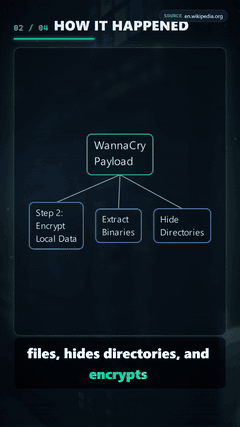
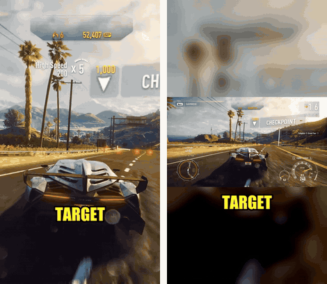

<p align="center"></p>

<h1 align="center">ShortsFlow</h1>

<p align="center"><b>Drop in a podcast or interview, get captioned vertical clips.<br/>Installed on your PC: no account, no API key, no upload.</b></p>

<p align="center">Free and open source (MIT), on your own PC: no watermark, no credits, no subscription.<br/>Also highlights videos, dubs, recaps, voice-overs, narrated explainers and YouTube uploads.</p>

<p align="center">
  <a href="https://pypi.org/project/shortsflow/"></a>
  <a href="https://pypi.org/project/shortsflow/"></a>
  <a href="LICENSE"></a>
  <a href="https://github.com/ghost1412/shortsflow/actions/workflows/tests.yml"></a>
  <a href="https://github.com/ghost1412/shortsflow/stargazers"></a>
  <a href="https://glama.ai/mcp/servers/ghost1412/shortsflow"></a>
</p>

<p align="center">
  
  &nbsp;&nbsp;
  
  <br/><sub><b>Clip it:</b> the 9:16 crop cuts to whoever is talking, with word-timed captions. &nbsp;|&nbsp; <b>Explain it:</b> one web page in, a narrated explainer with an animated diagram out (<code>--mode CASE</code>).</sub>
</p>

## Why ShortsFlow

| | ShortsFlow | Hosted clippers (Opus Clip, Klap, Vizard) |
|---|---|---|
| Price and watermark | Free, MIT, no watermark | Check their pages: plans and limits change |
| Your video | Clipped on your own PC | Uploaded to their servers |
| Setup | You install it, with a large first download | Nothing to install, and they may be more polished |

<a name="try-it-in-two-minutes"></a>

## Install

**Windows:** [⬇ Download ShortsFlow-Setup.exe](https://github.com/ghost1412/shortsflow/releases/latest/download/ShortsFlow-Setup.exe), open **ShortsFlow**, press **Try a 2-minute sample**, then **Start**. The installer is small, but the first run downloads about 2 GB (about 5 GB with an NVIDIA card) and takes several minutes. It is not code-signed yet: if Windows shows a blue box, choose **More info**, then **Run anyway**.

**Any OS** (needs Python 3.10+ and FFmpeg):

```bash
pip install "shortsflow[clip]"
shortsflow doctor              # "FIX" is needed to clip; "optional" adds features
shortsflow clip my_video.mp4   # vertical clips with plain captions
```

**The look of the demo:** animated captions (these need [Node.js](https://nodejs.org) 18+), and a crop that cuts to whoever speaks (`--layout auto`):

```bash
shortsflow init                # once: sets up the animated captions
shortsflow clip my_video.mp4 --captions --layout auto
```

**Mac or Linux, one line** (needs Python 3.10+ and FFmpeg; installs into `~/.shortsflow`):

```bash
curl -fsSL https://raw.githubusercontent.com/ghost1412/shortsflow/main/install.sh | sh
```

**Without installing:** [open it in Colab](https://colab.research.google.com/github/ghost1412/shortsflow/blob/main/ShortsFlow_Colab.ipynb). It runs on Google's servers, not your PC: you need a Google account, your video goes to Google, and setup takes a few minutes.

No account or API key is needed to clip a video. If it saves you a subscription, a ⭐ helps other people find it.

## What you can make

| | What you get | Good to know |
|---|---|---|
| ✂️ **Shorts** | Suggested moments from a long video as 9:16 clips framed on faces. Options: animated captions, a cut to the speaker (it can still pick the wrong person), an opening on the strongest line, silences cut | You choose which to keep |
| 🎬 **Highlights video** | One video of the strongest moments it finds, in their original order, at about the length you choose | Landscape, like the source |
| 🌍 **Dubbing** | Your video in another language, with translated subtitles. It can give up to 4 speakers different voices, told apart by pitch | Computer voices: no voice cloning, no lip-sync. Similar voices can get mixed up |
| 🧳 **Recaps** | Trips, weddings and events: a hook, title cards, a closing card and an itinerary, tall or wide | Can copy the pace of a reel you like |
| 🎙️ **Voice cloning** | A voice-over in your own voice from a 10 to 30 second recording, in seven tones | Needs a local voice server. Your voice, or a consenting person's |
| ⬆️ **YouTube upload** | Publish to your own channel, now or scheduled (the app must stay open) | Needs your own Google OAuth client; Google may keep uploads private until it reviews it. Other platforms go through Upload-Post, not yet tested with a live account |

Also: [explainer videos](docs/GUIDE.md#the-case-explainer-videos-written-from-your-sources) written from a web page or PDF, [talking presenters](docs/GUIDE.md#presenters-a-host-who-talks), animations, photo reels, quiz and facts shorts, and game clips.

## Game clips

<p align="center">
  
  <br/><sub>One moment, two views. <b>Left:</b> cropped to fill the screen (bigger car, no speedometer or map), <code>--game_framing crop</code>. <b>Right:</b> the whole picture, <code>--game_framing fit</code>. Left on automatic, ShortsFlow chooses between them.</sub>
</p>

```bash
shortsflow clip gameplay.mp4 --content game                      # automatic framing
shortsflow clip gameplay.mp4 --content game --game_framing fit   # always keep the whole picture
```

## No command line needed

<p align="center">
  
  <br/><sub>Open the app, pick a card, then review, edit and publish. Shown: shorts made from a public-domain NASA video.</sub>
</p>

Prefer a terminal? `shortsflow clip interview.mp4 --captions`. There is also Docker, a REST API, an MCP server for AI agents and a daily GitHub Action. [All commands](docs/GUIDE.md#what-it-makes).

## Your PC, your choice of AI

- **Clipping needs no cloud:** Whisper transcribes and FFmpeg renders on your PC.
- **Write with any model:** Ollama, Gemini, OpenAI, Claude, DeepSeek, Groq, OpenRouter or any OpenAI-compatible server. Looking at pictures works with Gemini or Ollama. [Set it up](docs/GUIDE.md#bring-any-ai-model-or-run-it-on-your-own-pc).
- **Know what leaves:** with AI keys or online features, text, pictures or videos can be sent to those services, and the default narration voice (Microsoft Edge) is online. If you choose a model, your text goes only to it; only Automatic tries others. [Full privacy list](docs/GUIDE.md#privacy-what-leaves-your-pc).

## How good are the picks?

Without an AI key, the picker's suggestions often differ from what a person would choose, so review them. [How we measure clip quality, with the weak spots](docs/BENCHMARKS.md).

## Help and contributing

- Something wrong? [Open an issue](https://github.com/ghost1412/shortsflow/issues) with the output of `shortsflow doctor --report` (no keys or folder names in it).
- [Guide](docs/GUIDE.md) · [All features and options](docs/FEATURES.md) · [Roadmap](ROADMAP.md)
- Footage credits. Podcast demo: [Lila Rose Podcast E143](https://www.youtube.com/watch?v=VIq8L_ZeqkA) by Lila Rose, shared on YouTube under the [Creative Commons Attribution licence](https://creativecommons.org/licenses/by/3.0); cropped, re-framed and captioned (changes made). Game demo: the author's own recording of Need for Speed Rivals; the game and its content belong to Electronic Arts, which does not endorse ShortsFlow. Explainer demo: made from a Wikipedia article; any stock footage in it is from [Pexels](https://www.pexels.com).

## License

MIT. Remotion (animated captions) has its own licence for companies above its size threshold; see [remotion.dev/license](https://remotion.dev/license).


