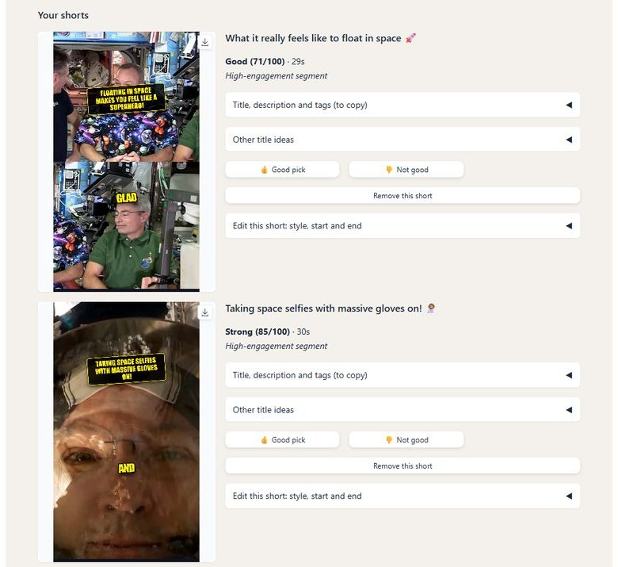

<p align="center"></p>

# ShortsFlow

> **Drop in a podcast or interview, get captioned vertical clips. No account, no API key, no upload.**
> Free and open source (MIT): no watermark, no credits, no subscription. Runs on your own PC.

<p align="center">
  <!-- DEMO VIDEO: replace with the YouTube link / thumbnail, e.g. [](https://youtu.be/XXXX) -->
  
  <br/><sub>A real run: the 9:16 crop cuts to whoever is talking, with word-timed captions.</sub>
</p>

<p align="center">
  <a href="https://pypi.org/project/shortsflow/"></a>
  <a href="https://pypi.org/project/shortsflow/"></a>
  <a href="LICENSE"></a>
  <a href="https://github.com/ghost1412/shortsflow/actions/workflows/tests.yml"></a>
  <a href="https://github.com/ghost1412/shortsflow/stargazers"></a>
</p>

## Try it in two minutes

| | |
|---|---|
| 🪟 **Windows, no setup** | [⬇ ShortsFlow-Setup.exe](https://github.com/ghost1412/shortsflow/releases/latest/download/ShortsFlow-Setup.exe), open **ShortsFlow**, press **Try a 2-minute sample**, then **Start**. |
| 🍎🐧 **Mac or Linux** | `curl -fsSL https://raw.githubusercontent.com/ghost1412/shortsflow/main/install.sh \| sh` (needs Python 3.10+ and FFmpeg; installs into `~/.shortsflow`). |
| 💻 **Any OS** | `pip install "shortsflow[clip]"`, then `shortsflow doctor`, then `shortsflow clip my_video.mp4` |
| ☁️ **Nothing to install** | [Open in Colab](https://colab.research.google.com/github/ghost1412/shortsflow/blob/main/ShortsFlow_Colab.ipynb) (free GPU) |

If it saves you a subscription, a ⭐ on this repo helps other people find it.

No account or API key is needed to clip a video. A key (or a free local Ollama) adds AI-written titles and descriptions and lets the AI pick and score the moments (a cloud provider then receives the transcript text).

<p align="center">
  
  <br/><sub>The browser app after a run on a public-domain NASA video: each short has a score, the reason it was picked and an editor. Tick "Let me review the moments first" to check the picks before anything is rendered.</sub>
</p>

## What you get from one long video

- **The moments.** Local Whisper reads the speech; clips start and end on sentences, skip a mic check or a mumbled opening, and never overlap. Every clip says why it was picked.
- **The framing.** Face-tracked 9:16 crops, a cut to whoever is speaking in a two-person talk, and the whole picture over a blurred copy for slides and screen recordings.
- **The captions.** Animated word-by-word captions (Hormozi, glow box, bounce), your logo and handle, and an editor to re-cut or restyle any clip.
- **Tighter pacing.** `--tighten` removes silences and pauses between words, never a spoken word, and keeps laughter and applause.

<p align="center">
  
  
  
  
  
  
  <br/><sub>Six of the 14 caption styles. Pick one in the app or with <code>--caption_style</code>.</sub>
</p>

```bash
# the one command most people need
shortsflow clip interview.mp4 --captions

# a podcast: cut to whoever is talking, remove silences, animated captions
python main.py --source_video "https://www.youtube.com/watch?v=VIDEO_ID" --extract_mode shorts \
  --clip_count 3 --layout auto --smart_crop --tighten --use_remotion --caption_style HORMOZI
```

## How good is it? We measure it

Clip quality is checked on public-domain and Creative Commons videos with no AI key at all, with a benchmark that runs on GitHub's runners
(`python scripts/clip_benchmark.py <session> --picture`): clips that start and end on a sentence, no overlap, length near the asked one,
a standalone opening line, titles that say only what the clip says, a face found and centred. The workflow is `.github/workflows/clip_benchmark.yml`. The results table, including the weak spots, is in [docs/BENCHMARKS.md](docs/BENCHMARKS.md). We do not claim to beat Opus Clip on every video; a side-by-side on public footage is the next thing to publish.

## ShortsFlow vs Opus Clip, Klap and Vizard

| | ShortsFlow | Opus Clip, Klap, Vizard |
|---|---|---|
| Price | Free, MIT | Subscription or credits |
| Watermark | None | On the free tier |
| Where your video goes | Stays on your machine; Whisper runs locally (text goes to an AI provider only if you add a key) | Uploaded to their cloud |
| Account | Not needed | Required |
| Best at | Podcasts and interviews, privacy, full control | Polish, hosted convenience |

## Privacy: what leaves your PC

Everything runs locally by default. Only these leave it, and each is optional: AI text providers (Gemini, Groq, Hugging Face, Ollama is local) receive the
transcript text when you set a key; Gemini receives small frames for `--visual_context` when a key is set; OpenStreetMap place names for trip recaps
(`--recap_no_geocode` turns it off); Microsoft's Edge voice service or ElevenLabs receive the text to speak in the dub and idea-to-video modes;
a short stock-footage search phrase per section goes to Pexels in `--mode CASE`; Google Drive upload and publishing to YouTube, TikTok and the rest through Upload-Post (the video and its title) only when you press Publish or switch on auto-publish in the app's Settings, which is off by default. A pasted YouTube link is downloaded to your PC; use your own files where the video's terms require it.
The transcript of each video you process is also kept on your PC in `~/.shortsflow/cache/transcripts` so it is not redone; delete that folder's files or set `SHORTSFLOW_TRANSCRIPT_CACHE=off` to stop it. If you start the browser app for other devices (`--host 0.0.0.0` or `--share`), visitors cannot use file paths or folder boxes; behind your own tunnel or reverse proxy, set `SHORTSFLOW_REMOTE=1` yourself.

## More than clips

Browser app, desktop studio, CLI, Docker, REST API, an MCP server for AI agents, dubbing, trip and event recaps, photo reels, step-by-step videos,
game moments, source-grounded explainers (`--mode CASE`: a topic plus a web page, PDF or arXiv paper, YouTube video or audio file in, a finished video out, with numbers checked against the source; `--mode ANIMATE`: one continuous animated explanation), a Settings page in the browser app for keys and publishing, and 30+ idea-to-video formats. They are documented in **[docs/FEATURES.md](docs/FEATURES.md)** (the full feature reference).

<p align="center">
  
  
  
  <br/><sub>Idea-to-video: a short from one line of text, a "spot the lie" facts short, and a case explainer made from a single web page (<code>--mode CASE</code>).</sub>
</p>

## Help and contributing

- Something wrong? [Open an issue](https://github.com/ghost1412/shortsflow/issues) with the output of `shortsflow doctor --report` (it prints no keys and no folder names).
- Status, known issues and how to verify a change: [ROADMAP.md](ROADMAP.md). Tests: `python -m pytest` (offline).
- Sample footage in the demos is public domain or Creative Commons and credited where used.

## License

MIT. Remotion (animated captions) has its own licence for companies above its size threshold; see [remotion.dev/license](https://remotion.dev/license).
