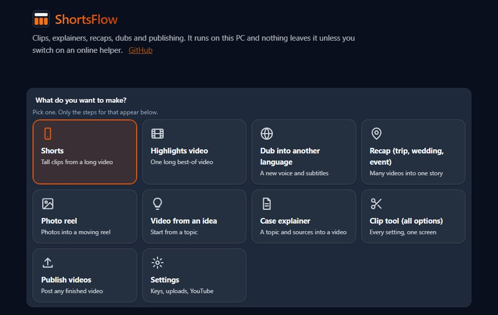
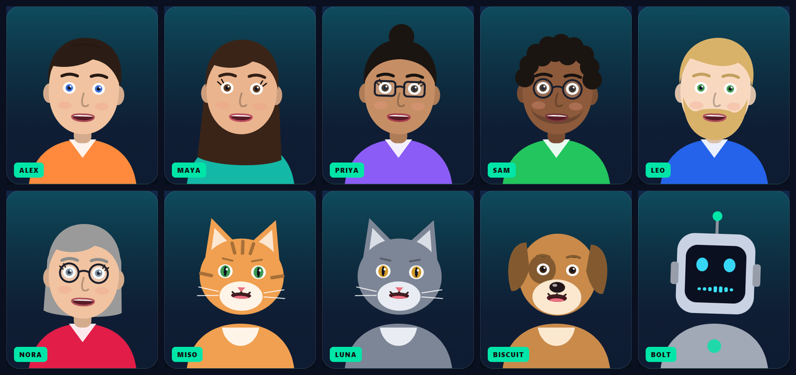

<p align="center"></p>

# ShortsFlow

> **Drop in a podcast or interview, get captioned vertical clips. No account, no API key, no upload.**
> And it does much more: it cuts a long video into one **highlights video** of the best moments that still tells the whole story, it **dubs** a video into another language, makes **recaps** of a trip, wedding or event, turns photos into reels, writes and animates **explainers** from a web page, PDF or arXiv paper, makes idea-to-video shorts, and **publishes** and schedules them.
> Free and open source (MIT): no watermark, no credits, no subscription. Runs on your own PC.

<p align="center">
  
  &nbsp;&nbsp;
  
  <br/><sub><b>Clip it:</b> the 9:16 crop cuts to whoever is talking, with word-timed captions. &nbsp;|&nbsp; <b>Explain it:</b> one web page in, a narrated explainer with an animated diagram out (<code>--mode CASE</code>).</sub>
</p>

<p align="center">
  <a href="https://pypi.org/project/shortsflow/"></a>
  <a href="https://pypi.org/project/shortsflow/"></a>
  <a href="LICENSE"></a>
  <a href="https://github.com/ghost1412/shortsflow/actions/workflows/tests.yml"></a>
  <a href="https://github.com/ghost1412/shortsflow/stargazers"></a>
  <a href="https://glama.ai/mcp/servers/ghost1412/shortsflow"></a>
  
</p>

## What it makes

| You give it | You get | One line |
|---|---|---|
| A long video, a YouTube link, a podcast | **Captioned 9:16 shorts**: moments picked on sentence boundaries, face-tracked crops, a cut to whoever speaks, word-by-word captions, silences removed | `shortsflow clip interview.mp4 --captions` |
| A long video (a talk, a match, a film, an event) | **One highlights video**: the best moments, kept in story order so the whole story is still told, at the length you choose (a few minutes up to as long as you like), landscape like the source, with transitions and optional captions | the **Highlights video** card, or `python main.py --source_video talk.mp4 --extract_mode long --target_duration 300 --reel_captions` |
| A topic and sources (web page, PDF, arXiv paper, YouTube, audio) | **A sectioned explainer video** (16:9 and 9:16): the script is written only from your sources and its numbers are checked against them, with narration, Mermaid diagrams, Manim animation, stock footage, captions and music | `python main.py --mode CASE --prompt "The topic" --sources LINK` |
| A topic | **One continuous animated explanation** (equations, processes, algorithms) | `python main.py --mode ANIMATE --prompt "How binary search halves the work"` |
| One line of text | **Idea-to-video shorts**: facts, would-you-rather, stories, 30+ formats | `python main.py --mode FACTS --category "space mysteries"` |
| Trip, wedding, event or family footage | **A recap**: the best moments, a hook, day and stop cards, a closing card and an itinerary, in tall and wide versions, with the look matched to the footage | the **Recap** tab, or `--mode TRIP` |
| A video in one language | **A dub** in another: transcribed, translated sentence by sentence, re-voiced, the original audio ducked, translated subtitles burned in; with several people talking, each gets their own voice (no lip-sync) | `python main.py --mode DUB --source_video talk.mp4 --target_lang es --dub_captions --dub_speakers auto` |
| 3 or more photos | **A photo reel** with music: memories, travel, product, then vs now, countdown or tribute; blurry and duplicate photos skipped | `python main.py --mode PHOTO_REEL --photos_dir photos --reel_type travel` |
| A game recording | **Game moments** as shorts, keeping the whole picture and HUD in frame | `shortsflow clip gameplay.mp4 --content game` (see [docs/FEATURES.md](docs/FEATURES.md)) |
| Any finished video | **Published** to YouTube, TikTok, Instagram, X and more, now or at a time you set | the **Publish videos** card in the app |

<p align="center">
  
  
  
  
  
  <br/><sub>Clips, a case explainer, an animated explainer, a facts short and a recap. All made by ShortsFlow from public-domain or Creative Commons material.</sub>
</p>

<p align="center">
  
  
  <br/><sub>The browser app (<code>shortsflow webui</code>), in dark mode: a card for each thing you can make, and a Publish videos card for posting any finished video now or at a time you set.</sub>
</p>

**Why it is different from a clipper.** Most tools stop at "cut a long video into shorts". ShortsFlow also writes the video: the case explainer reads your sources, drafts a script that only uses what they say (a number the source does not contain is rejected), draws each scene as a diagram, animation or footage, narrates it and renders both shapes. Everything runs on your PC with a local Whisper, a local FFmpeg and an optional local Ollama; a cloud AI key only makes the writing better and is never required to clip.

**Built to be automated.** A browser app (a card per task, a Publish videos card, Settings for keys and your own YouTube channel), a desktop studio, a CLI, Docker, a REST API (`python -m shortsflow.api`, with an n8n flow), an MCP server for AI agents, a scheduler for posts, and a daily GitHub Action that makes and posts a short by itself. 1,300+ offline tests run on every push.

## Try it in two minutes

| | |
|---|---|
| 🪟 **Windows, no setup** | [⬇ ShortsFlow-Setup.exe](https://github.com/ghost1412/shortsflow/releases/latest/download/ShortsFlow-Setup.exe), open **ShortsFlow**, press **Try a 2-minute sample**, then **Start**. |
| 🍎🐧 **Mac or Linux** | `curl -fsSL https://raw.githubusercontent.com/ghost1412/shortsflow/main/install.sh \| sh` (needs Python 3.10+ and FFmpeg; installs into `~/.shortsflow`). |
| 💻 **Any OS** | `pip install "shortsflow[clip]"`, then `shortsflow doctor`, then `shortsflow clip my_video.mp4` |
| ☁️ **Nothing to install** | [Open in Colab](https://colab.research.google.com/github/ghost1412/shortsflow/blob/main/ShortsFlow_Colab.ipynb) (free GPU) |

If it saves you a subscription, a ⭐ on this repo helps other people find it.

No account or API key is needed to clip a video. A key (or a free local Ollama) adds AI-written titles and descriptions and lets the AI pick and score the moments (a cloud provider then receives the transcript text).

<p align="center">
  
  <br/><sub>The browser app after a run on a public-domain NASA video: each short has a score, the reason it was picked and an editor. Tick "Let me review the moments first" to check the picks before anything is rendered.</sub>
</p>

## What you get from one long video

- **The moments.** Local Whisper reads the speech; clips start and end on sentences, skip a mic check or a mumbled opening, and never overlap. Every clip says why it was picked.
- **The framing.** Face-tracked 9:16 crops, a cut to whoever is speaking in a two-person talk, and the whole picture over a blurred copy for slides and screen recordings.
- **The captions.** Animated word-by-word captions (Hormozi, glow box, bounce), your logo and handle, and an editor to re-cut or restyle any clip.
- **Tighter pacing.** `--tighten` removes silences and pauses between words, never a spoken word, and keeps laughter and applause.

<p align="center">
  
  
  
  
  
  
  <br/><sub>Six of the 14 caption styles. Pick one in the app or with <code>--caption_style</code>.</sub>
</p>

```bash
# the one command most people need
shortsflow clip interview.mp4 --captions

# a podcast: cut to whoever is talking, remove silences, animated captions
python main.py --source_video "https://www.youtube.com/watch?v=VIDEO_ID" --extract_mode shorts \
  --clip_count 3 --layout auto --smart_crop --tighten --use_remotion --caption_style HORMOZI
```

## Presenters: a host who talks

<p align="center">
  
</p>

Give a case explainer a drawn host in the corner who talks with the narration: the mouth follows the words, it blinks, raises its brows and nods. Pick one of the ten above (`--case avatar=maya`), or build your own on the **Presenters** card: any look for a person, or a cat, a dog or a robot, with a talking preview. Each one speaks with its own voice (choose from eleven, with a Listen button). It can suggest the look from your photo (read on your PC).

**Optional: your real face.** An add-on (about 5 GB, NVIDIA GPU, installed with one button) makes a photo of you talk with the narration, made on your PC with SadTalker. Only your own face, or someone who agreed.

## The case explainer: videos written from your sources

```bash
python main.py --mode CASE --prompt "How the Heartbleed bug worked" --sources https://en.wikipedia.org/wiki/Heartbleed
python main.py --mode CASE --prompt "The topic" --sources LINK --case plan_only     # write the script, edit script.json, then render
python main.py --mode CASE --case help                                              # every option
```

- **Grounded.** Sources are read (web pages, including ones that need JavaScript, PDFs, arXiv, YouTube captions or local transcription, audio and video files). The script may only use what they say, and numbers, names and quotes are checked against the text.
- **Drawn, not stock slides.** Each section picks a layout: Mermaid diagrams (flowcharts, sequence, state, mind maps, drawn large with a camera that follows long chains), Manim animation, timelines, counters, checklists, or footage. Layout is fitted by measurement, so nothing overlaps the captions.
- **Templates.** case, postmortem, history, explainer, recipe, news, animation and story (drawn characters over painted skies, for a narrated tale), with a hook for the first seconds.
- **A presenter if you want one.** A drawn host who talks with the narration: people of different looks, cats, a dog or a robot, or your own built in the app (it can suggest the look from your photo, read on your PC).
- **Local fallbacks.** Gemini, then other providers, then local Ollama if the cloud is rate-limited. The Edge voice takes over if ElevenLabs is out of credits.

## How good is it? We measure it

Clip quality is checked on public-domain and Creative Commons videos with no AI key at all, with a benchmark that runs on GitHub's runners
(`python scripts/clip_benchmark.py <session> --picture`): clips that start and end on a sentence, no overlap, length near the asked one,
a standalone opening line, titles that say only what the clip says, a face found and centred. The workflow is `.github/workflows/clip_benchmark.yml`. The results table, including the weak spots, is in [docs/BENCHMARKS.md](docs/BENCHMARKS.md). We do not claim to beat Opus Clip on every video; a side-by-side on public footage is the next thing to publish.

## ShortsFlow vs Opus Clip, Klap and Vizard

| | ShortsFlow | Opus Clip, Klap, Vizard |
|---|---|---|
| Price | Free, MIT | Subscription or credits |
| Watermark | None | On the free tier |
| Where your video goes | Stays on your machine; Whisper runs locally (text goes to an AI provider only if you add a key) | Uploaded to their cloud |
| Account | Not needed | Required |
| Best at | Podcasts and interviews, privacy, full control | Polish, hosted convenience |

## Privacy: what leaves your PC

Everything runs locally by default. Only these leave it, and each is optional: AI text providers (Gemini, Groq, Hugging Face, Ollama is local) receive the
transcript text when you set a key; Gemini receives small frames for `--visual_context` when a key is set; OpenStreetMap place names for trip recaps
(`--recap_no_geocode` turns it off); Microsoft's Edge voice service or ElevenLabs receive the text to speak in the dub and idea-to-video modes;
a short stock-footage search phrase per section goes to Pexels in `--mode CASE`; a presenter's photo stays on your PC (only if you choose Gemini to suggest a look from it is it sent to Google), and the presenter's voice sample line goes to the Edge voice service; Google Drive upload and publishing to YouTube, TikTok and the rest through Upload-Post (the video and its title) only when you press Publish or switch on auto-publish in the app's Settings, which is off by default. A pasted YouTube link is downloaded to your PC; use your own files where the video's terms require it.
The transcript of each video you process is also kept on your PC in `~/.shortsflow/cache/transcripts` so it is not redone; delete that folder's files or set `SHORTSFLOW_TRANSCRIPT_CACHE=off` to stop it. If you start the browser app for other devices (`--host 0.0.0.0` or `--share`), visitors cannot use file paths or folder boxes; behind your own tunnel or reverse proxy, set `SHORTSFLOW_REMOTE=1` yourself.

## More than clips

Browser app, desktop studio, CLI, Docker, REST API, an MCP server for AI agents, dubbing, trip and event recaps, photo reels, step-by-step videos,
game moments, source-grounded explainers (`--mode CASE`: a topic plus a web page, PDF or arXiv paper, YouTube video or audio file in, a finished video out, with numbers checked against the source; `--mode ANIMATE`: one continuous animated explanation), a Publish videos card and a Settings card in the browser app (keys, your own YouTube channel, scheduled posts), and 30+ idea-to-video formats. They are documented in **[docs/FEATURES.md](docs/FEATURES.md)** (the full feature reference).

## Help and contributing

- Something wrong? [Open an issue](https://github.com/ghost1412/shortsflow/issues) with the output of `shortsflow doctor --report` (it prints no keys and no folder names).
- Status, known issues and how to verify a change: [ROADMAP.md](ROADMAP.md). Tests: `python -m pytest` (offline).
- Sample footage in the demos is public domain or Creative Commons and credited where used.

## License

MIT. Remotion (animated captions) has its own licence for companies above its size threshold; see [remotion.dev/license](https://remotion.dev/license).
