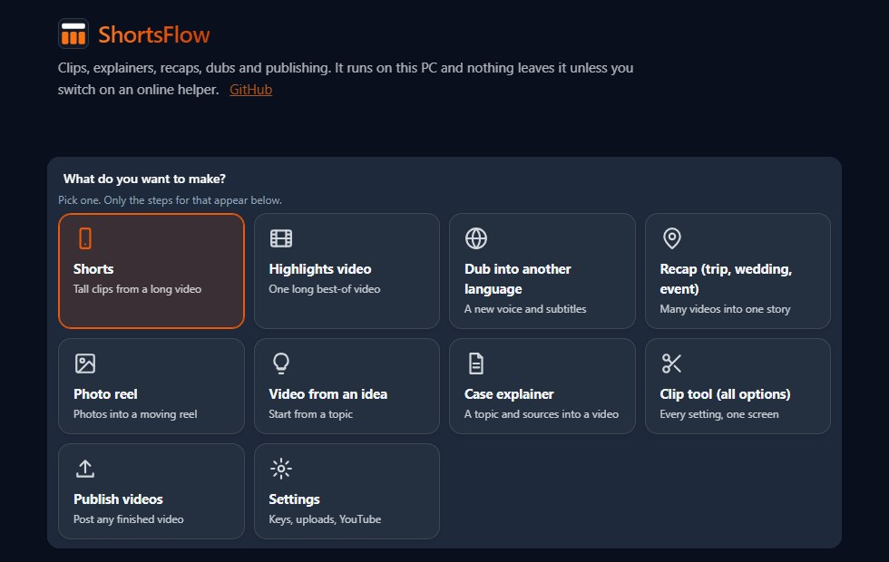
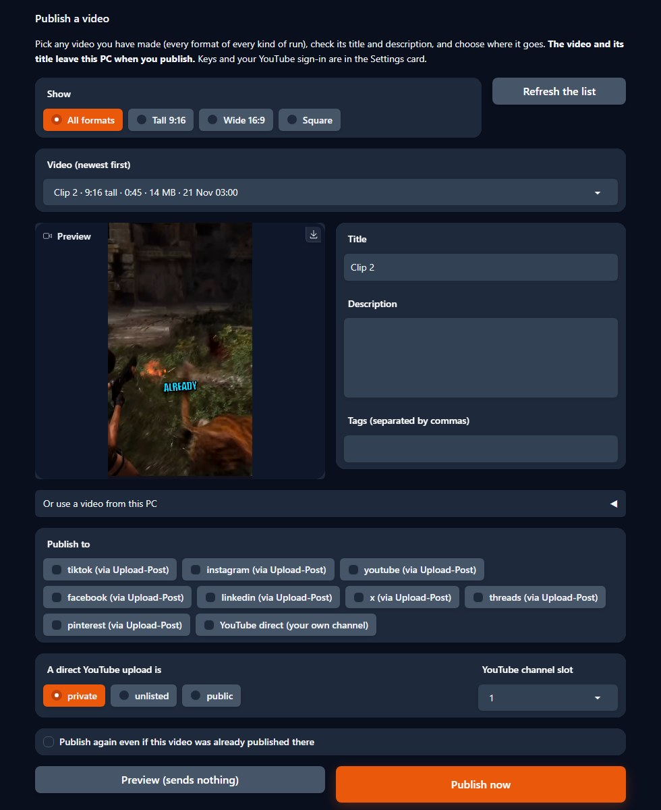
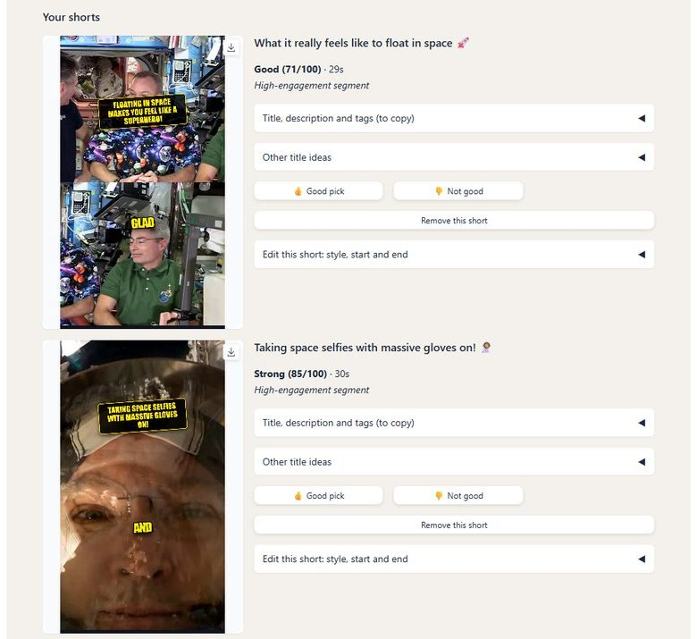
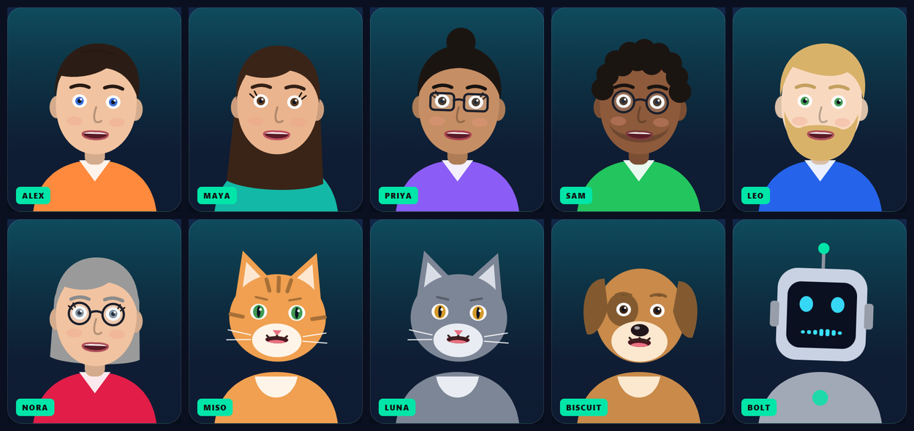

# ShortsFlow guide

What each part does, how to run it with your own AI model, and what can leave your PC. Start at the [README](../README.md); every option is in [FEATURES.md](FEATURES.md).

## Bring any AI model, or run it on your own PC

**Writing** (moments, titles, scripts) works with Ollama, Gemini, OpenAI, Anthropic Claude, DeepSeek, Groq, OpenRouter, or any OpenAI-compatible server such as LM Studio. Hugging Face is a last fallback. Pick one with `--llm_provider` and `--llm_model`, or in `.env`:

```env
LLM_PROVIDER=custom
LLM_BASE_URL=http://localhost:1234/v1/chat/completions
LLM_MODEL=the-model-name
```

Looking at pictures is narrower for now: Gemini or an Ollama vision model.

Cloud keys are optional. The local choices:

| Job | Local | How |
|---|---|---|
| Transcribing | Whisper | the default for clipping |
| Picking moments, titles, writing | [Ollama](https://ollama.com) | `--llm_provider ollama` (or `LLM_PROVIDER=ollama` in `.env`); explainers: `--case llm=local` |
| Looking at pictures (story-aware picking, recaps, checking story drawings) | An Ollama vision model, such as `gemma3` | `SHORTSFLOW_VISION=ollama` |
| Narration | Kokoro (`pip install "shortsflow[local-voice]"`), or your own voice server | `--tts_provider kokoro`. Its word timings are estimates. The default is Microsoft's online Edge voice |
| Pictures | Drawn by code | explainers: `--case background=none` uses no stock footage |
| Rendering | FFmpeg, Remotion, Manim | always on your PC |

```bash
ollama pull qwen2.5:7b
python main.py --source_video talk.mp4 --extract_mode shorts --clip_count 3 --llm_provider ollama
python main.py --mode CASE --prompt "The topic" --sources LINK --case llm=local --case background=none --tts_provider kokoro
```

If you choose a model, it is the only one your text is sent to; if it cannot answer, you get an error (in 0.9.4 and earlier the app could go on to another provider you had a key for). Only Automatic tries several. For explainers, `--case llm=local` writes with Ollama only; their default (`llm=auto`) turns to Ollama on your PC when the chosen cloud model fails. A small local model usually writes weaker text than a large cloud one. Web sources and first-time model downloads still need the internet; for everything that can leave your PC, see [Privacy](#privacy-what-leaves-your-pc).

## What it makes

Open the app with `shortsflow webui` and pick a card.

| You give it | You get | In the app |
|---|---|---|
| A long video, a YouTube link, a podcast | **Captioned 9:16 shorts**, face-tracked, cut to whoever speaks | **Shorts** |
| A long video (a talk, a match, an event) | **One highlights video**: the best moments in story order, at the length you choose | **Highlights video** |
| A topic and sources (web page, PDF, arXiv, YouTube, audio) | **A narrated explainer** (16:9 and 9:16) with diagrams, animation and captions | **Case explainer** |
| A script and a recording of your voice | **A voice-over in your voice** (needs a local voice server) | **Voice-over in your voice** |
| A topic | **One continuous animated explanation** | **Case explainer**, animation template |
| One line of text | **Idea-to-video shorts**: facts, would-you-rather, stories, 30+ formats | **Video from an idea** |
| Trip, wedding, event or family footage | **A recap** with a hook, day and stop cards and an itinerary | **Recap** |
| A video in one language | **A dub** in another, a voice per speaker, translated subtitles (no lip-sync) | **Dub into another language** |
| 3 or more photos | **A photo reel** with music; blurry and duplicate photos skipped | **Photo reel** |
| A game recording | **Game moments** as shorts, HUD kept in frame | **Clip tool**, game option |
| Any finished video | **Published** to your YouTube channel, or elsewhere through Upload-Post, now or later | **Publish videos** |

<details>
<summary>Command line</summary>

```bash
shortsflow clip interview.mp4 --captions
python main.py --source_video talk.mp4 --extract_mode long --target_duration 300
python main.py --mode CASE --prompt "The topic" --sources LINK
python main.py --mode ANIMATE --prompt "How binary search halves the work"
python main.py --mode FACTS --category "space mysteries"
python main.py --mode TRIP --help
python main.py --mode DUB --source_video talk.mp4 --target_lang es --dub_captions --dub_speakers auto
python main.py --mode VOICEOVER --voiceover help
python main.py --mode PHOTO_REEL --photos_dir photos --reel_type travel
shortsflow clip gameplay.mp4 --content game
```

</details>

Every mode and option: **[docs/FEATURES.md](FEATURES.md)**.

<p align="center">
  
  
  
  <br/><sub>A Manim animation, a facts short and a recap, all made by ShortsFlow.</sub>
</p>

<p align="center">
  
  
  <br/><sub>The browser app (<code>shortsflow webui</code>), in dark mode: a card for each thing you can make, and a Publish videos card for posting any finished video now or at a time you set.</sub>
</p>

## Shorts that hold attention

<p align="center">
  
  <br/><sub>The browser app after a run on a public-domain NASA video: each short has a score, the reason it was picked and an editor. Tick "Let me review the moments first" to check the picks before anything is rendered.</sub>
</p>

- **Picks with a reason.** Local Whisper reads the speech; clips start and end on sentences and do not overlap. Each one gets a label (strong, good, okay, weak) and the reason. It is a guide, not a promise of views.
- **A stronger start.** `--cold_open` opens with the clip's strongest line, and `--hook_overlay` shows the hook as a big title (with `--use_remotion`).
- **Tighter and cleaner.** `--tighten` cuts silences, `--enhance auto` corrects the picture, `--enhance_audio` masters the sound.
- **Framing that follows.** Face-tracked 9:16 crops, a cut to whoever is speaking, and the whole picture over a blurred copy for slides and screens.
- **Your look.** Animated word-by-word captions, your logo and handle, and an editor to re-cut or restyle any clip.

<p align="center">
  
  
  
  
  
  
  <br/><sub>Six of the 14 caption styles. Pick one in the app or with <code>--caption_style</code>.</sub>
</p>

**In the app:** **Shorts** card.

<details>
<summary>Command line</summary>

```bash
# the one command most people need
shortsflow clip interview.mp4 --captions

# a podcast with a cold open, a hook title, tighter pacing and animated captions
python main.py --source_video "https://www.youtube.com/watch?v=VIDEO_ID" --extract_mode shorts --clip_count 3 \
  --layout auto --smart_crop --tighten --cold_open --use_remotion --hook_overlay --caption_style HORMOZI
```

</details>

## Highlights video

One video of the best moments of a talk, match, film or event. The moments stay in their original order, you choose the length, and it is landscape like the source, with optional transitions and captions.

**In the app:** **Highlights video** card.

<details>
<summary>Command line</summary>

```bash
python main.py --source_video talk.mp4 --extract_mode long --target_duration 300 --reel_captions
```

</details>

## Dubbing

A video in one language, a dub in another: transcribed, translated sentence by sentence and spoken by computer voices, with translated subtitles. It can give each of 2 to 4 speakers a different voice, and you choose the tone and delivery. Speakers are told apart by the pitch of their voices only, so similar voices, or one person whose pitch moves a lot, can get the wrong voice; without `--dub_speakers` the whole video has one voice. It does not clone the speakers' voices and does not lip-sync.

**In the app:** **Dub into another language** card.

<details>
<summary>Command line</summary>

```bash
python main.py --mode DUB --source_video talk.mp4 --target_lang es --dub_captions --dub_speakers auto
```

</details>

## Recaps: trips, weddings, events

Several videos in, one recap out: a hook, day or stop cards, a closing card and a written itinerary. It can make tall and wide versions, keep the clips' own sound under the music, copy the pace of a reference reel (`--recap_like`), or stop with a plan for you to review first (`--recap_plan_only`).

**In the app:** **Recap** card (command line: `--mode TRIP`). Options: [docs/FEATURES.md](FEATURES.md).

## Voice cloning: a voice-over in your voice

A script and a 10 to 30 second recording of you in, an audio file out, in seven tones. It runs on your PC through a local voice server: your own (VoiceStudio, F5-TTS or XTTS), or an optional add-on of about 5.5 GB. Use only your own voice, or the voice of someone who agreed.

**In the app:** **Voice-over in your voice** card.

<details>
<summary>Command line</summary>

```bash
python main.py --mode VOICEOVER --script script.txt --voiceover sample=my_voice.wav --voiceover tone=warm
```

</details>

## Upload to YouTube and more

- **Straight to your own YouTube channel.** In the browser app, connect it once with your own Google OAuth client, then publish as private, unlisted or public. No third party in between. A new Google app may be limited to private uploads until Google reviews it, and Google's daily quota allows only a few.
- **Other platforms** (TikTok, Instagram, Facebook, LinkedIn, X and more) go through [Upload-Post](https://upload-post.com). This route has only been tested against mocks, not a live account.
- **Before and after.** Edit the title, description and tags, preview without sending anything, publish now or schedule it (the app must be open). It will not post the same video twice to a platform unless you ask.
- **On autopilot.** A daily GitHub Action can make and post a short by itself; the [@spottheliee](https://www.youtube.com/@spottheliee) channel is run this way.

## The case explainer: videos written from your sources

Most tools stop at cutting a long video into shorts. ShortsFlow can also write one: it reads your sources, drafts a script from them, draws each scene, narrates it and renders both shapes.

**In the app:** **Case explainer** card.

<details>
<summary>Command line</summary>

```bash
python main.py --mode CASE --prompt "How the Heartbleed bug worked" --sources https://en.wikipedia.org/wiki/Heartbleed
python main.py --mode CASE --prompt "The topic" --sources LINK --case plan_only     # write the script, edit script.json, then render
python main.py --mode CASE --case help                                              # every option
```

</details>

- **Checked against your sources.** Web pages (including ones that need JavaScript), PDFs, arXiv, YouTube captions or local transcription, and audio and video files. The script is asked to use only what they say, and a sentence with a number or a name they never mention is removed. That check cannot tell whether an event is told correctly, so check the facts before you publish.
- **Drawn, not stock slides.** Mermaid diagrams (drawn large, with a camera that follows long chains), Manim animation, timelines, counters, checklists or footage. Layout is fitted by measurement to keep it clear of the captions.
- **Templates.** case, postmortem, history, explainer, recipe, news, animation and story, with a hook for the first seconds.
- **Your choice of model.** [Any of the models above](#bring-any-ai-model-or-run-it-on-your-own-pc); `--case llm=local` writes only with Ollama on your PC. The Edge voice takes over if ElevenLabs is out of credits.

### Presenters: a host who talks

<p align="center">
  
</p>

A drawn host in the corner talks with the narration: the mouth follows the words, it blinks, raises its brows and nods. Pick one of the ten above (`--case avatar=maya`), or build your own on the **Presenters** card: a person, a cat, a dog or a robot, with a talking preview and a choice of eleven voices. It can suggest the look from your photo (read on your PC).

**Optional: your real face.** An add-on (about 5 GB, NVIDIA GPU, installed with one button) makes a photo of you talk with the narration, on your PC with SadTalker. Only your own face, or someone who agreed.

### Story videos (new, still rough)

`--case template=story` makes a narrated tale drawn by code, with characters and gold name plates over painted skies. Before rendering, ShortsFlow reviews its own story: it tries to add people, creatures and objects the narration needs, replaces or removes pictures that do not fit, and lists what is still missing. Expect flat, still figures with one shared face shape, no action, and drawings that vary in quality. Main characters can be missing. **Animal stories do not work yet:** an animal can appear as a person or only as its name. With a small local model (we tried qwen2.5:7b) the pictures were mostly wrong or empty, even though the run reports success. Watch the result, and read the review file in the run folder, before you share it. [Details](FEATURES.md).

**In the app:** **Case explainer**, story template card.

<details>
<summary>Command line</summary>

```bash
python main.py --mode CASE --prompt "The story" --sources LINK_TO_THE_STORY --case template=story --case formats=9:16 --case draft
```

</details>

## How good is it? We measure it

Clip quality is checked on public-domain and Creative Commons videos with no AI key at all, with a benchmark that runs on GitHub's runners
(`python scripts/clip_benchmark.py <session> --picture`): clips that start and end on a sentence, no overlap, length near the asked one,
a standalone opening line, titles that say only what the clip says, a face found and centred. The workflow is `.github/workflows/clip_benchmark.yml`. The results table, including the weak spots, is in [docs/BENCHMARKS.md](BENCHMARKS.md). We do not claim to beat Opus Clip on every video; a side-by-side on public footage is the next thing to publish.

## ShortsFlow or a hosted clipper?

How ShortsFlow differs from hosted services such as Opus Clip, Klap and Vizard. Their plans change, so check their own pages.

| | ShortsFlow | Hosted clippers |
|---|---|---|
| Price | Free, MIT | Usually a subscription or credits |
| Watermark | None | Often on free plans |
| Where your video goes | Stays on your machine; Whisper runs locally | Uploaded to their cloud |
| Account | Not needed | Usually required |
| Setup | You install it and run it on your own PC | Nothing to install |
| Best at | Podcasts and interviews, privacy, full control | Polish, convenience |

## Automate it

A browser app, a desktop studio, a CLI, Docker, a REST API, an MCP server for AI agents, a scheduler for posts, and a daily GitHub Action that makes and posts a short by itself. More than 1,700 offline tests run on every push.

## Privacy: what leaves your PC

Everything runs locally by default. What can leave is optional.

<details>
<summary><b>See exactly what is sent, where, and how to keep it local</b></summary>

| What leaves | Where it goes | When, and how to keep it local |
|---|---|---|
| Transcript text; for explainers, the topic and the text of your sources; for story videos, the narration | The AI model you choose. With Automatic: the providers you have keys for, one after another until one answers | Cloud providers need a key. `--llm_provider ollama` sends nothing to a cloud writer |
| Small video frames | Gemini | `--visual_context`, a photo reel's `--smart_story` (the photos) and picture descriptions, with a Gemini key. `SHORTSFLOW_VISION=ollama` uses a local vision model |
| Drawings of objects and creatures in a story video, with a list of names | Gemini | The drawing check, with a Gemini key. `SHORTSFLOW_VISION=ollama` keeps them local |
| Prompts for generated pictures | Gemini or Hugging Face | AI images, with a key. Cartoon backgrounds: `--case cartoon=local` or `cartoon=drawn` |
| GPS positions from your footage | OpenStreetMap, for place names | Trip recaps. `--recap_no_geocode` turns it off |
| The text to speak (and a presenter's voice sample line) | Microsoft's Edge voice service or ElevenLabs | Narrated and dubbed videos. A local voice option, where a mode has one, stays on your PC |
| Short stock-footage search phrases | Pexels | When stock footage or photos are used |
| A presenter's photo | Google, only if you choose Gemini to suggest a look from it | Otherwise it stays on your PC |
| The video and its title | Google Drive, or Upload-Post for YouTube, TikTok and the rest | Only when you press upload or publish, or switch on auto-publish (off by default) |

- A pasted YouTube link is downloaded to your PC; use your own files where the video's terms require it.
- Transcripts are cached in `~/.shortsflow/cache/transcripts` so they are not redone. Delete those files, or set `SHORTSFLOW_TRANSCRIPT_CACHE=off`.
- If you open the browser app to other devices (`--host 0.0.0.0` or `--share`), visitors cannot use file paths or folder boxes. Behind your own tunnel or reverse proxy, set `SHORTSFLOW_REMOTE=1` yourself.

</details>

---

Recap demo footage: six stock videos by Poiana11 on Wikimedia Commons, [CC0](https://creativecommons.org/publicdomain/zero/1.0/).
